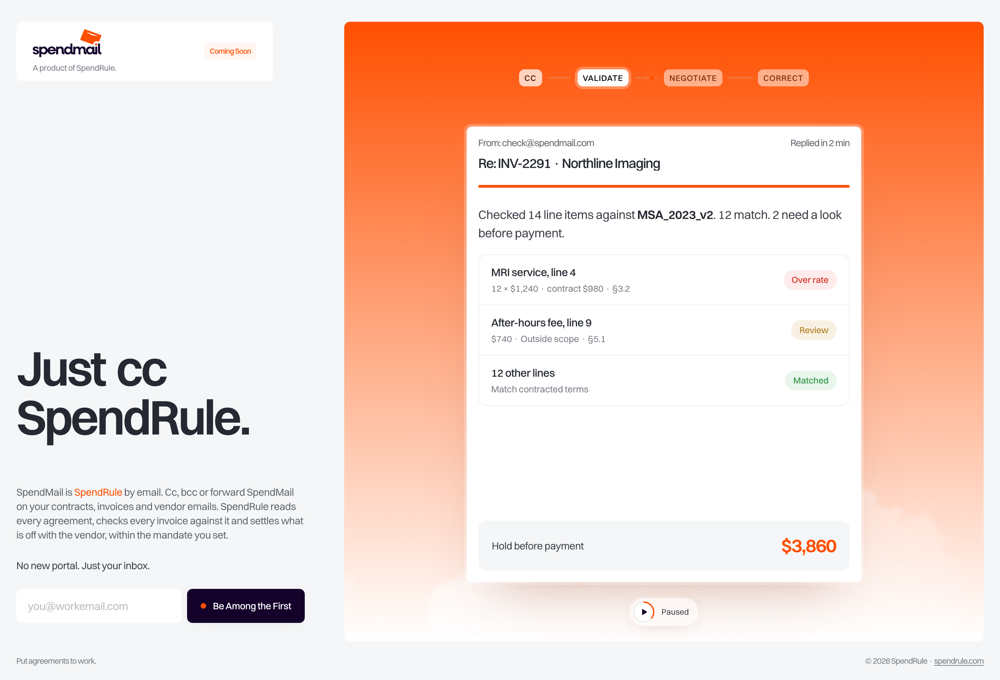

# SpendMail

Coming-soon page for SpendMail ("Just cc SpendRule."), built from the SpendRule Website Design Figma file (frame 3275:7920).

Live: https://spendmail.vercel.app



## What's on the page

- Animated email card that walks through the four steps (CC → Validate → Negotiate → Correct) on one ~28 second loop. The chips jump between steps, hovering the card pauses it, and the button in the panel's top-right plays or pauses.
- Paper-plane logo that flies in on load, sends on hover, and turns toward a nearby cursor.
- Endless strip of random `@spendmail.com` aliases under the card.
- Waitlist form with validation. It has no backend yet: the email is only kept in the visitor's browser (`localStorage`).
- Responsive down to phones; honours reduced-motion settings.

## Run it locally

Static HTML, CSS and JS with no build step. Serve the folder with any static server, for example:

```bash
python3 -m http.server 4960
```

Then open http://localhost:4960. Add `?t=12.5` to open the demo paused at that second.

## Deploy

```bash
vercel deploy --prod --yes
```

`.vercelignore` leaves out the preview images, the unused `assets/clouds.png` and Markdown files.
